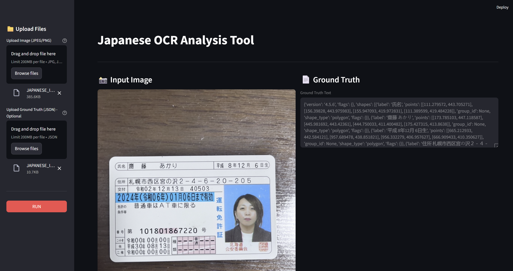
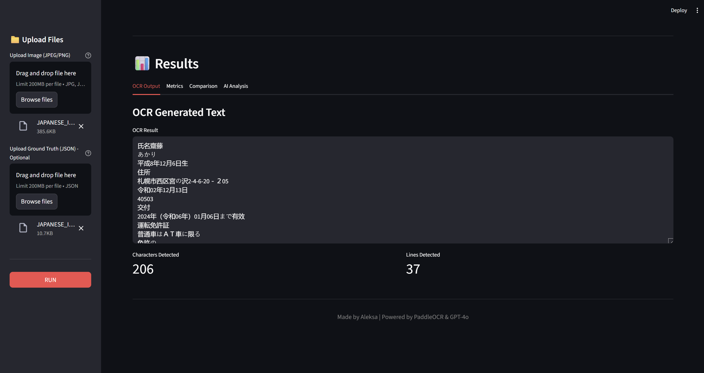
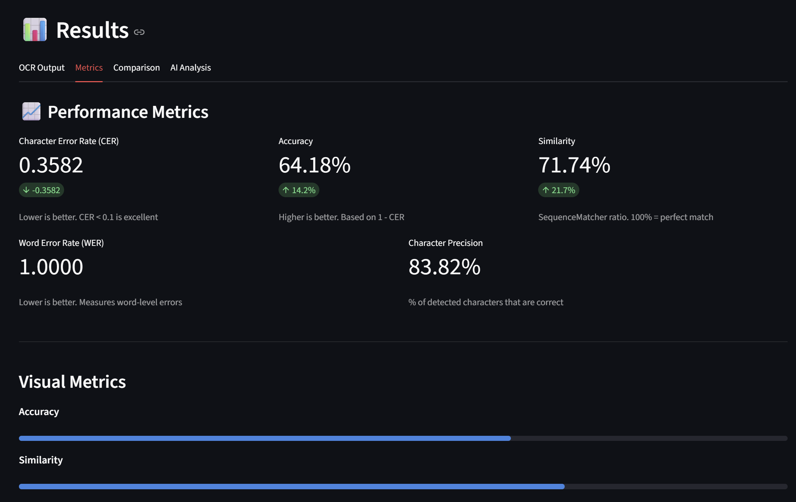
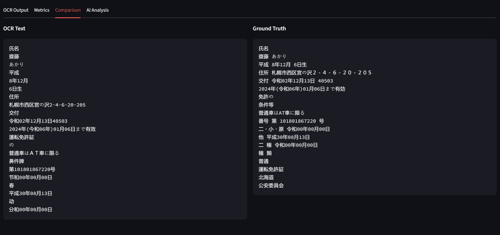
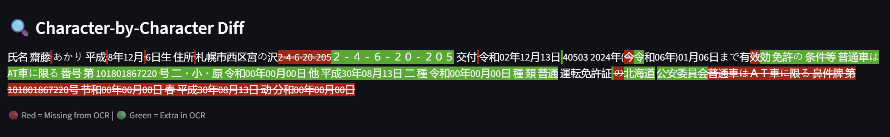
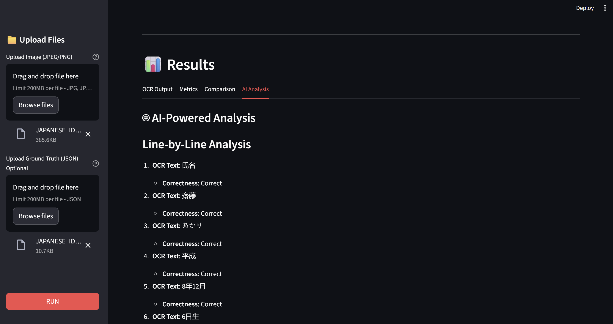
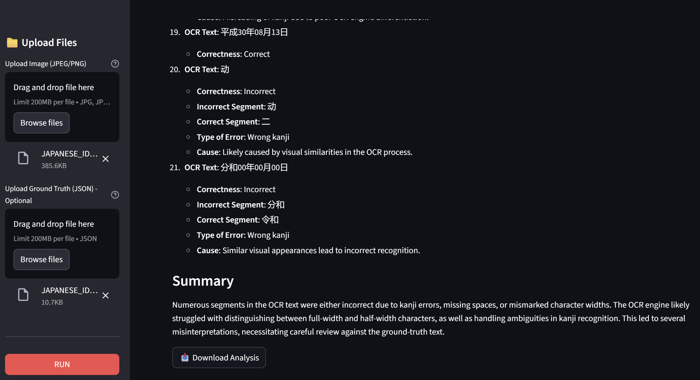

# Japanese OCR Error Analysis Tool

This project is a pipeline for **Japanese text OCR evaluation and error analysis**.

## Research background

This tool grew out of a research phase carried out during an internship at the Department of Systems Theory and Control, Faculty of Organizational Sciences (FON), University of Belgrade, in December 2025. The research had two parts:

1. **OCR engine benchmark.** Tesseract, PaddleOCR and Surya were evaluated on Japanese documents across 11 categories (bills, contracts, forms, ID cards, newspapers and more), using Character Error Rate (CER), with and without image preprocessing (cropping, Sauvola and adaptive thresholding).
2. **ID card error analysis.** OCR output for five Japanese ID documents (114 text lines) was compared with ground truth line by line, and every incorrect line was classified by error type.

| Engine | Mean CER (lower is better) |
|---|---|
| PaddleOCR | **0.583** |
| Surya | 0.744 |
| Tesseract | 0.840 |

Key findings:

- PaddleOCR had about 30% lower CER than Tesseract and was chosen as the engine for this tool.
- Thresholding improved PaddleOCR by a further 7.5%, while barely helping Tesseract.
- On ID cards, the worst failures came from layout segmentation (the engine reading the wrong regions of the card), not from misreading characters. Wrong-kanji substitutions were the most common single error type (29.5% of incorrect lines).

These findings shaped the tool: line-by-line comparison, error-type classification and AI-assisted explanations of why OCR fails.

Full reports (in Serbian):

- [OCR benchmark: Tesseract vs PaddleOCR vs Surya](docs/research/OCR_benchmark.pdf)
- [ID card OCR error analysis](docs/research/ID_cards_error_analysis.pdf)

## Overview

The system combines:

- **PaddleOCR** for performing OCR on Japanese text images
- A **GPT-4o–based AI agent** for detailed, line-by-line analysis of OCR errors

The goal is not only to extract text, but to **understand where and why OCR errors occur**.

## OCR Pipeline

- OCR is performed using **PaddleOCR**
- The pipeline supports Japanese writing systems (kanji, hiragana, katakana)
- OCR results can be evaluated using standard metrics (e.g. CER)
- The OCR component runs in an isolated environment due to dependency constraints

## AI Error Analysis

- A **GPT-4o agent** compares the OCR output with ground-truth text
- The agent provides:
  - Line-by-line comparison
  - Identification of incorrect segments
  - Classification of error types (wrong kanji, missing characters, kana confusion, etc.)
  - Explanations of likely OCR failure causes (visual similarity, segmentation issues, font effects)

## Architecture

- **Streamlit** is used as the frontend for image upload, ground-truth input, and result visualization
- **FastAPI** is used to reliably connect components running in separate Python environments
- OCR and AI analysis run in **isolated environments** to avoid dependency conflicts
- Components communicate via HTTP services for stability and reproducibility

## Purpose

This tool is designed for:

- OCR quality evaluation
- Dataset validation
- Error forensics in Japanese document OCR
- Research and development workflows

## How It Works

The Japanese OCR Analysis Tool provides a comprehensive interface for analyzing OCR accuracy on Japanese documents. Here's a walkthrough of the main features:

### 1. Upload and Input

The application features a clean, intuitive interface where you can:

- Upload your Japanese document image (JPEG/PNG, max 200MB)
- Optionally upload ground truth data in JSON format for accuracy comparison
- Process the image with a single click using the "RUN" button

### 2. OCR Results

After processing, the application displays:

- **OCR Generated Text**: The extracted Japanese text from your document
- **Characters Detected**: Total number of characters recognized (e.g., 206)
- **Lines Detected**: Number of text lines identified (e.g., 37)

The OCR output preserves the original text structure and formatting.

### 3. Performance Metrics

The tool provides detailed performance analytics:

**Performance Metrics:**

- **Character Error Rate (CER)**: Measures character-level accuracy (lower is better, <0.1 is excellent)
- **Word Error Rate (WER)**: Evaluates word-level errors
- **Accuracy**: Overall correctness percentage (higher is better, based on 1 - CER)
- **Similarity**: SequenceMatcher ratio showing text similarity (100% = perfect match)
- **Character Precision**: Percentage of detected characters that are correct

**Visual Metrics:**

- Interactive bar charts for Accuracy and Similarity percentages
- Green indicators showing improvement trends

### 4. Side-by-Side Comparison

Compare OCR results against ground truth:

- **OCR Text** (left): The extracted text from the image
- **Ground Truth** (right): The reference text for comparison
- Easy visual comparison to identify discrepancies

### 5. Character-by-Character Analysis

Detailed character-level difference highlighting:

- **Red text**: Characters missing from OCR output
- **Green text**: Extra characters in OCR output
- Inline visualization makes it easy to spot specific errors
- Perfect for fine-tuning and debugging OCR accuracy

### 6. AI-Powered Analysis

GPT-4o provides intelligent, line-by-line analysis of OCR results:

- **Correctness Assessment**: Each line is evaluated as "Correct" or "Incorrect"
- **OCR Text Display**: Shows the extracted text for each line
- Automatically identifies which lines were accurately recognized

For incorrect segments, the AI provides detailed insights:

- **Incorrect Segment**: Highlights the specific text that was misrecognized
- **Correct Segment**: Shows what the text should have been
- **Type of Error**: Categorizes the error (e.g., "Wrong kanji")
- **Cause**: Explains why the error likely occurred (e.g., "Visual similarities in the OCR process")
- **Summary**: Comprehensive analysis of overall OCR performance and common error patterns

**Download Analysis**: Export the complete AI analysis as a TXT file for documentation and review purposes.

---

All results are powered by PaddleOCR and GPT-4o for accurate Japanese text recognition and analysis.

It is recommended to run the **agent service** and the **OCR service** in separate Python environments, as they have different and often conflicting dependencies, which helps avoid instability and dependency hell.
